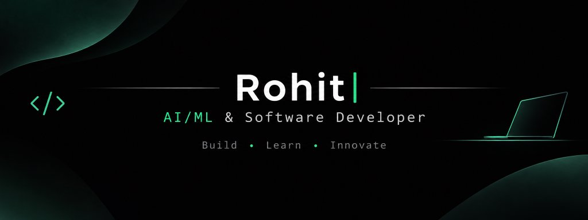

  

&nbsp;

---

## About Me

I am a Computer Science and Engineering undergraduate specializing in **Artificial Intelligence and Machine Learning** (Class of 2028). I focus on building practical, end-to-end software applications that integrate deep learning models, AI APIs, and resilient backend services into usable products.

- **Focus Areas**: AI/ML engineering, computer vision systems, and full-stack software development.
- **Current Priorities**: Strengthening Data Structures and Algorithms in **Java** and backend architecture with **Python & FastAPI**.
- **Opportunities**: Actively seeking **AI/ML and Software Engineering internship** opportunities.

---

## Technical Skills

| Domain | Technologies |
| :--- | :--- |
| **Languages** |        |
| **AI & Machine Learning** |      |
| **Frameworks & Web** |     |
| **Databases** |    |
| **Cloud & AI APIs** |    |
| **Tools & Platforms** |     |
| **Operating Systems** |    |

---

## Featured Projects

### [IrisAI](https://github.com/rohitt-prog/IrisAI)

Deep-learning-based eye-condition screening application — 3-model weighted ensemble (DenseNet-121, EfficientNet-B4, ResNet-50), Gemini-powered explanations, multilingual voice consultation, and PDF screening reports.

> ⚕️ *Not a substitute for professional medical diagnosis.*

🔗 [github.com/rohitt-prog/IrisAI](https://github.com/rohitt-prog/IrisAI)

### [WorkflowOS](https://github.com/rohitt-prog/WorkflowOS)

Workflow discovery and automation engine — detects recurring cross-application task patterns from activity logs using sequence-alignment analysis, then executes them through a human-approved, fail-safe pipeline.

🔗 [github.com/rohitt-prog/WorkflowOS](https://github.com/rohitt-prog/WorkflowOS)

---

## GitHub Statistics

---

## Connect With Me

&nbsp;

&nbsp;

 

`rohit9.mwsp@gmail.com` — open to internships and meaningful collaborations.

---

Built with precision and continuous curiosity • © Rohit

